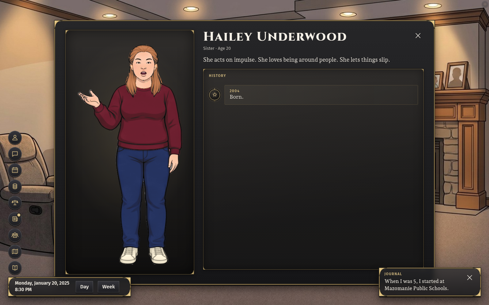
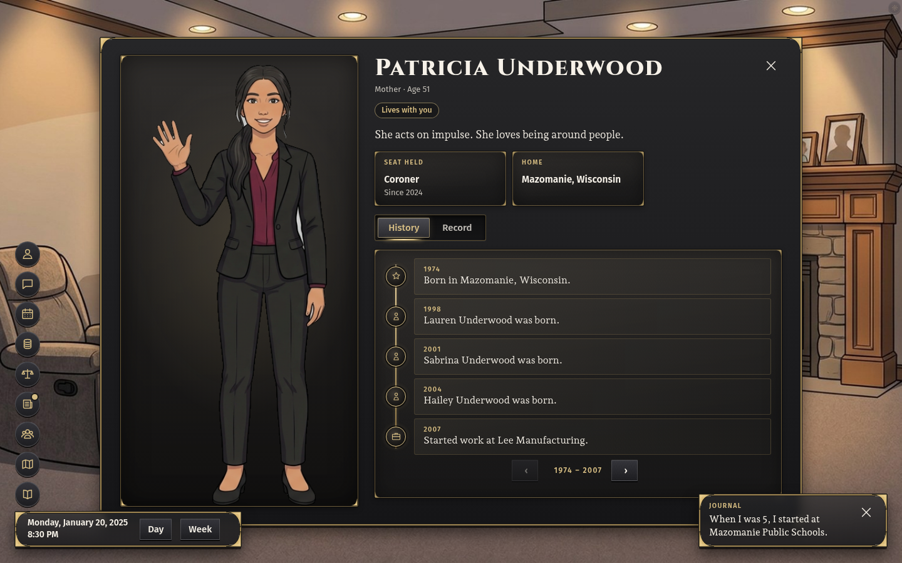

# First minutes: sibling names

Status: generated names and the agreed creator call are implemented; twenty drawn generated lives and the creator/browser regression pass. Current source 91012586fb. Ten fresh creator regressions and a fresh-town New Game check also pass; timing remains. No Path 1 Built or Verified claim.

## Reproduction

Mazomanie, Wisconsin (5550225), replay b37762f4-7895-40f5-8d83-0634db5b60cb, reproduces on base cf31d0ed63: player Evelyn Underwood, person_526f98c72f070459, born 2007-01-27; living sister Evelyn Underwood, person_f277a01c09158a60, born 2001-07-09. With the generator correction the player remains Evelyn and the same sister is Sabrina; the other siblings remain Riley and Lauren. Generated names change before family facts and the opening history are constructed. The wider population retains the generated name in its counted record for fill-in.

## Break-it check

sibling-names.test.ts passed in Mazomanie and Madison, New York. Restoring both original generators failed Mazomanie on the two Evelyn records; Madison passed. Restoring the correction passed both again. The first ablation attempt was interrupted by the environment startup and produced no test result; the recorded result is the completed retry. No test or expectation was loosened.

## Drawn lives

Each command uses OCD_STORAGE_OVERRIDE="cloud session, owner approved Oct 14", NODE_OPTIONS=--max-old-space-size=8192 and GOLDEN_PATH_SEED=<replay>: npm test -- src/core2/sibling-names.test.ts --maxWorkers=1. Each invocation checks a fresh drawn town plus the pinned Mazomanie regression. The table counts only the fresh towns. Per-run logs and exit codes: /tmp/lane-2-sibling-fresh/.

| Town                          | Place key | Replay           | World seed                                                       | Result |
| ----------------------------- | --------- | ---------------- | ---------------------------------------------------------------- | ------ |
| Madison, New York             | 3644424   | 3f9c85898019ebff | 531af62d2399236aeb7beb78b41f759578bfe2ce47ddda2f62b0279951105074 | Pass   |
| Manchester, Maryland          | 2449950   | 9f27e7e0459bc055 | e7f1e6e6d010383da4d1f0572d624a109114bc0253004d67a11d27d471f5aa4f | Pass   |
| Tiptonville, Tennessee        | 4774540   | bce2acb42a5e685a | 3515f49e5cd380fd48fa0de81300c27227b3fff230265299fc0409895a9e8959 | Pass   |
| Milton, New Hampshire         | 3348580   | fce6b57622fc1ae0 | 6d2d2229f398b1583930c10d67009c0a1590d72fd09874f9957049d4885d0991 | Pass   |
| Cumberland Hill, Rhode Island | 4420260   | 2a88ebd672aecc54 | 5d0ec5db26cec7fc773655d162ffffd0953a5b1eed2e2a31fc77675e86a004d4 | Pass   |
| Manchester, Connecticut       | 0944690   | 1283dcd435e4b28e | fe8c67375aa6622cfcacab19374d4f7fc52fcd779693cdeaa9cf6f47c64d6f41 | Pass   |
| Harriston, Virginia           | 5135640   | cc821b209eff28ed | 4c2882b9280195b2648eaefd0827a3494770e11cfd4473fc1dde820815e702d3 | Pass   |
| Island Park, Idaho            | 1640600   | 34f29b4aa1540336 | f410748f79d05c62328be1d41920b194a448014b24071aa917ee27e04d80f41d | Pass   |
| Staves, Arkansas              | 0566800   | 6b0dc83837271dc8 | 9b387112f61c09ee71b2a30985e06bd7010e86ff873ab599490b76d5ec4af1d4 | Pass   |
| Elk Grove, Pennsylvania       | 4223112   | dd352cabd8beadf5 | ef11e2c9e89f5bf642bdeaf264dca18c3fff225c94b868566df4987b28cf165d | Pass   |
| Plandome, New York            | 3658475   | 24f8fc667e07937a | 871b8e553663fdd787eaa5d7eaeed4e3c080327579e62478c1e0be397871be42 | Pass   |
| Amagon, Arkansas              | 0501270   | dc154677a36520c5 | edf8583a7b2eee834f794b0a091df1da59c4f0af02e1a9adbf3f4fb1be1e6f2c | Pass   |
| East Stone Gap, Virginia      | 5124720   | 2cfc461a50662e31 | 6ad90ca194093e8c3237e86d3b04d2ffae124b25e4a720e0aeaed3e69f00ec58 | Pass   |
| Gibbon, Nebraska              | 3118615   | 08b5e43cc5ccf49b | 7cc7e1182f3f740a9342748034ccd87a18076b385740fbaac5cbfa0f73b14764 | Pass   |
| Centennial, Wyoming           | 5613440   | 32f0e19818fd0e83 | 0cba21b7c181887272259a1015e01af72f8d036816c05cf2af05fe59fabedb42 | Pass   |
| East Globe, Arizona           | 0421410   | f988c956af9f8a10 | 67cab2dcd193a11164c197e82fc67454778d73886a3d3796f2cd94af44840d8a | Pass   |
| Grand Junction, Colorado      | 0831660   | 5294d2613f4982ff | 00624d3ec991972cbbcccfef003273a8816bc09c3ff032b1a76c8008bde0825b | Pass   |
| Bellewood, Kentucky           | 2105464   | fc8df4634499560b | 92730fe319e71d32fba42157dc1339bd29816c7effcad2e81d48a4ae1bb97e6c | Pass   |
| Sardis, Mississippi           | 2865560   | 7c27f6294212b8c0 | 930a7094cab89c873ac76b31bc7f2b55b572efbdd3d5cb1365b66fe17aca957b | Pass   |
| Riviera Beach, Maryland       | 2466850   | fca7ce020263b56c | 2ae878569aa929a01ef20cac3a87aab69145b9e090a445c3e1227d28f7461f9d | Pass   |

## Creator seam and break-it checks

Lane 5 accepted the narrow identity-writer call: [agreement](../agreements/2-5.md), [acceptance](https://github.com/lamontaes/Political-Game-Git/pull/7144#issuecomment-6617602731). The shared edit is only an import and the resolver call in the existing sibling birthday loop. The chosen player name stays; each living sibling's actual record gets a distinct name. The call supplies the gender recorded in looks, and the existing corpus/cohort generator chooses the name. Surname, identity, relations, looks and birthday handling are preserved.

Choosing RILEY in Mazomanie previously left both the player and sibling person_f277a31c09158f79 named Riley. Corrected source keeps player person_526f98c72f070459 as RILEY Underwood and names that sibling Hailey Underwood. The test checks case-insensitive uniqueness, unchanged family/identity records and the recorded gender's admitted name pools. All three tests pass on Mazomanie plus drawn Madison. Restoring the original writer fails uniqueness; restoring the call that omitted gender fails the gender-pool assertion. Corrected bytes were restored after both ablations. Logs: /tmp/lane-2-sibling-{creator,gender}-{after,ablation}.log. Main's parent-birthday integration changed living-link counts to 131 in Mazomanie and 113 in Madison; distinct names still hold.

## Browser proof

Source 91012586fb; Mazomanie (5550225), replay b37762f4-7895-40f5-8d83-0634db5b60cb. New Game through the creator with RILEY Underwood, female, born January 27, 2007. The sibling card displays Hailey Underwood. Patricia Underwood's history displays “Hailey Underwood was born.” from record person_526f96c72f0700f3:family:person_f277a31c09158f79. The check asserts that exact record ID and rendered sentence. New Game and two advances return 200; the final advance runs one simulated day, 79 decisions and acts. Zero page errors. Raw responses: test-results/lane-2-sibling-creator/{family,result}.json; runner /tmp/lane-2-sibling-browser.mjs.

## Final creator fresh draws

Source 91012586fb. All ten runs passed all three tests. Each keeps the pinned Mazomanie regressions beside this fresh drawn town. Logs: /tmp/lane-2-sibling-creator-fresh/.

| Town (place key)                       | Replay           | World seed                                                       | Result |
| -------------------------------------- | ---------------- | ---------------------------------------------------------------- | ------ |
| Alpine, Arkansas (0501090)             | e4aebb5e6f089b6c | 1dc14352bad4a41c3d0878573b641a0a06eda1de0f2b9b7215055fbd80a61003 | Pass   |
| Barnesville, Maryland (2404475)        | 034e0080bfd7d5fb | 4d186e9658621a02c4c9baca1403f0c82b39f140643ab7df246233675320c286 | Pass   |
| Joyce, Louisiana (2238880)             | 8270db2255f28010 | 0abdc85c60c59628e09fdbe6c1c65858bfd7b992b91024c5a8b378bf131dffdd | Pass   |
| Scotia, South Carolina (4564465)       | 239cb5c7eef98a2f | 28a46e8463d2f301ec316154a72b131c257b9060d18d5875a5df8f3d24aac5c3 | Pass   |
| Dakota City, Nebraska (3112000)        | 0e1b180d88b6c233 | 9fe23688e16fdc84a3790005991fb786cd762bf86ca63a0aba60fe5f113bc657 | Pass   |
| Stovall, North Carolina (3765320)      | fcf073e9483f611e | 2287f0ded243535b8f673dddcc0f330b3dd98b0931ce623f0a3921ddf2b3c7b5 | Pass   |
| Manzano, New Mexico (3546730)          | 51069ea8ff9a263b | 4b1fda1b277217c13216a44ae7c921ac508d4b4b75f2cc63978282ceaa5c74f4 | Pass   |
| Walcott, Iowa (1981705)                | fbf8f853b573206d | d65f4a468d1f582fc2ca0c5ae1873f28d4fe3246eab2812281154a681898c95a | Pass   |
| Salmon, Idaho (1671650)                | e4eae20593cf0937 | 3b2c697ffcdd46e1f03f5c6500985fb281eb6d64f9cb023cb0a6a4e379a6881a | Pass   |
| Merion Station, Pennsylvania (4248768) | 2aea5d424ceb294a | 7c6587e1a2afb8b6ea08342ce4884e9308997d9faec9ad90acc69871efeae16a | Pass   |

New Game check: Sun River, Montana, replay 83d2ffd7cd4ba37e; four weeks of normal play, scene and Journal returned 200. Log: /tmp/lane-2-sibling-newgame.log.

Still required: four-year timing, all eight First minutes finish-line towns and a non-builder's confirmation on main. Future births during play remain unexplored by this opening item.
