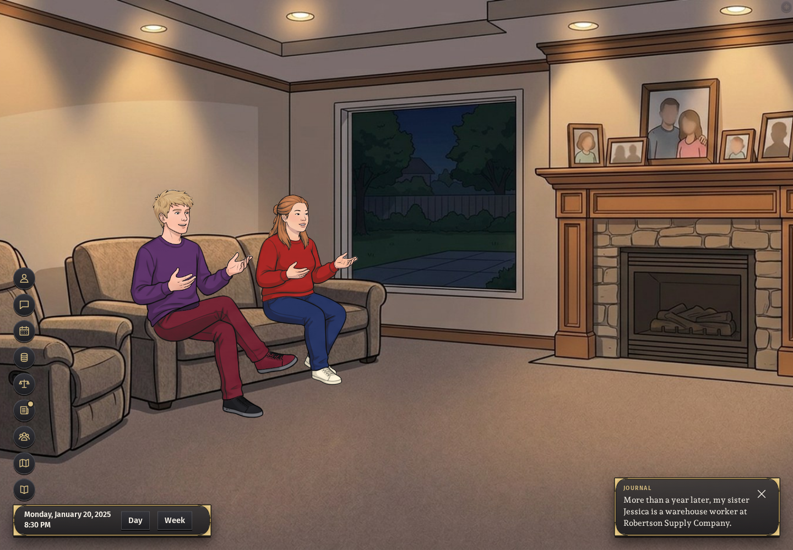

# Astra cloud trial — November 7, 2026

A new game opened in Weyers Cave, Virginia, replay `ccaa02338851a0bf`, and
played four weeks through the game's request handler without crashing. The
browser displayed the same opening with no page errors.

Base: main `b407ca221a3d603b98cc77b22778c5318fa2ecb8`.

- `gh auth status`: passed, lamontaes, HTTPS.
- Checkout: reused the environment's provisioned clone, fetched current main,
  and created `astra/trial`; a fresh clone download was not tested.
- `npm install --no-audit --no-fund`: passed.
- `npm run bench`: listening on port 3000.
- `npm run new-game-check`: passed, replay above, four weeks, all requests 200.
  Opening took 9.1 seconds. This is not a year speed measurement.
- Browser: Playwright Chromium, 1440 × 1000, `/play`, opened through
  `/api/newlife` and Continue. No developer fixtures were inserted.

Every npm command used `OCD_STORAGE_OVERRIDE="cloud session, owner approved Oct 14"`
and `NODE_OPTIONS=--max-old-space-size=8192`.

Failures and recovery: the default Playwright browser path was absent; setting
`PLAYWRIGHT_BROWSERS_PATH=/workspace/.playwright-browsers` used the installed
browser. An exact uppercase button-name selector timed out; the screen's
`new-game` test ID worked. The requested report
`docs/reports/law-levels-2026-11-05.md` is absent on this main. PRs #7308–#7319
were read instead, alongside AGENTS.md and the top of OWNER-DECISIONS.md.

This trial changes no game behavior. None of the four law-levels acceptance
conditions is claimed complete by this report.
