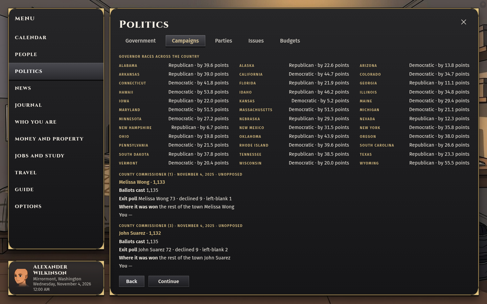
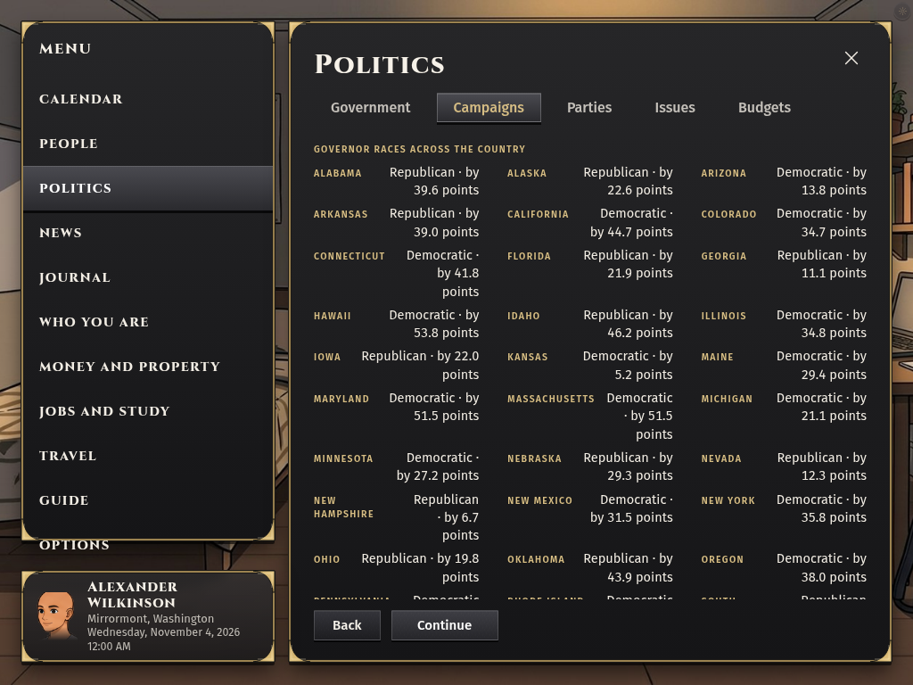
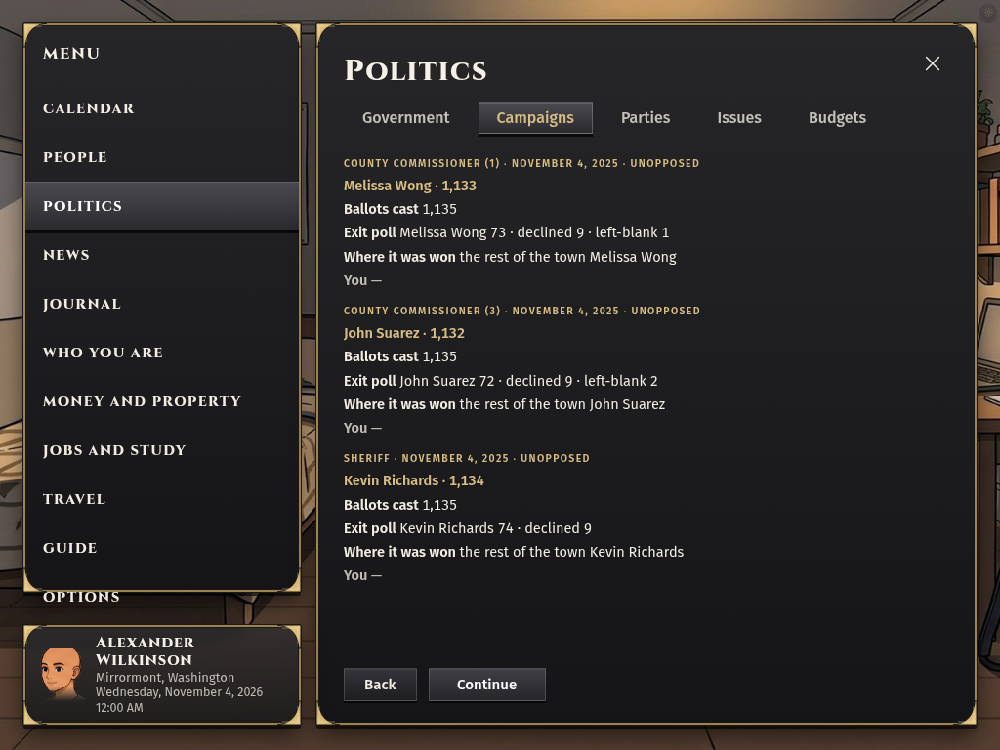

# Governor results pagination audit

Merger 3, October 27, 2026. Checked main commit `6dd3fab28c1dfb0fdfd8fab00c37f2d4ffdb2763`, with no source edits. Bench HTML, CSS and JavaScript response bytes matched the checked files.

Ordinary New game → New world drew **Mirrormont, Washington**, seed `d8301713-281d-43c0-9133-d339e717cff7`. No dev mode, forced click, mocked response or injected record. Existing public advance/resume, polling-place leave and job-offer decline producers reached the 2026 election. The displayed date is November 4, 2026. A fresh browser used Continue, closed the automatically opened Election night panel, then opened Politics → Campaigns through the visible menu.

The original harness tried an obsolete ring-button selector after Continue; that selector timed out because Election night now opens automatically. It was corrected to use the visible close and menu controls in the same world. That timeout is not a product-failure claim.

## Native result

- At **1440×900**, all **36** governor race IDs were readable through the real pager; each displayed state, party and rounded margin matched `/api/results/nation`.
- At **1024×768**, only **27 of 36** rows were fully readable across every pager page. The Nation block extends below the sheet. The missing rows are Pennsylvania, Rhode Island, South Carolina, South Dakota, Tennessee, Texas, Vermont, Wisconsin and Wyoming. The sheet ends at y=672; those rows run from y=659.98 through y=840.36. The next page moves to older local races and never exposes them.
- No page errors were reported. Screenshots were inspected at both sizes. The visible clipping overrides record/test success.

`play-governor-races-on-screen` remains open for this responsive-pagination repair and the separate owner installed-build acceptance. The implementation merged in PR #6159; this audit does not undo that merge. Fix `.nation-grid` and its single `.row.race.nation` container so every recorded race remains reachable at the smaller viewport.
